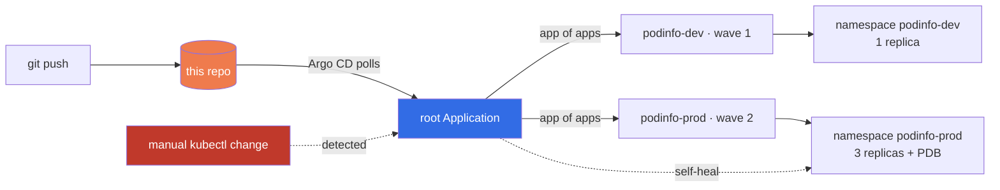

# GitOps on Kubernetes with Argo CD

[](https://github.com/sadvi11/gitops-argocd-kubernetes/actions/workflows/gitops-verify.yml)


Git is the only way into this cluster. Nothing is deployed by a pipeline running
`kubectl apply` — Argo CD pulls the desired state from this repository, and
anything that drifts from it gets put back automatically.

**The CI job proves that claim rather than asserting it.** It stands up a real
three-node cluster, installs Argo CD, syncs from this repo, then deliberately
scales production down by hand and fails the build unless Argo CD reverts it.

## Why pull beats push

| | Push (CI runs `kubectl apply`) | Pull (Argo CD, this repo) |
|---|---|---|
| Cluster credentials | Live in the CI system | Never leave the cluster |
| Manual `kubectl` change | Silently persists | Reverted automatically |
| "What is actually running?" | Read the pipeline logs | Read the repo |
| Rollback | Re-run an old pipeline | `git revert` |
| Blast radius of a stolen CI token | Full cluster admin | No cluster access to steal |

That last row is the one that matters most. A push pipeline needs standing
credentials to your cluster; this design has none to leak.

## Architecture



Only `apps/root-app.yaml` is ever applied by hand. It points at `apps/`, which
holds the child Applications — so adding an environment means committing a file,
not running a command.

## What the pipeline actually verifies

Every push and pull request:

- every overlay builds with Kustomize
- output is schema-checked with `kubeconform -strict`, so an unknown field is an
  error rather than a silently ignored typo
- **security invariants are asserted against rendered output** — `runAsNonRoot`,
  `allowPrivilegeEscalation: false`, `readOnlyRootFilesystem`, and no `:latest`
  tag. A future overlay that patches those away fails the build.

On `main`, additionally:

- a three-node kind cluster is created and Argo CD installed
- the root app is applied, and both children must reach **Synced** and **Healthy**
- declared state is confirmed: `dev=1`, `prod=3`, PDB present in prod and absent
  in dev — proving the overlays genuinely diverge
- **drift test** — production is scaled to 1 replica directly against the
  cluster; the build fails unless Argo CD restores it to 3 with no human action
- **prune test** — a resource that exists in the cluster but not in git is
  confirmed removed

## Run it yourself

Needs Docker, `kubectl`, `kind`, `kustomize`. Costs nothing — everything is local.

```bash
make up          # 3-node kind cluster
make argocd      # install Argo CD
make bootstrap   # apply ONLY the root app
make status      # both environments, created from git alone

make drift       # scale prod to 1 and watch it heal back to 3
make ui          # Argo CD dashboard at https://localhost:8080
make down        # delete everything
```

## Design decisions worth defending

**Three nodes, not one.** A single-node cluster cannot demonstrate a
PodDisruptionBudget doing anything — prod would look healthy for the wrong
reason.

**Kustomize overlays, not duplicated YAML.** Dev and prod share one base. The
difference between environments is a diff you can read, which is exactly the
question an interviewer asks.

**A PDB in prod only.** It stops a node drain from taking every replica at once
— the classic way a routine cluster upgrade becomes an outage.

**Pinned image tags, no `:latest`.** A mutable tag means the cluster and git can
disagree about what is running, which defeats the point of GitOps. CI enforces
this.

**Default-deny NetworkPolicy.** Without it, any compromised pod in the cluster
can reach this workload.

## Repository layout

```
.
├── apps/                 # Argo CD Applications (root + children)
├── workloads/podinfo/
│   ├── base/             # shared manifests, hardened by default
│   └── overlays/
│       ├── dev/          # 1 replica, lower limits
│       └── prod/         # 3 replicas + PodDisruptionBudget
├── kind/cluster.yaml     # 3-node local cluster
├── .github/workflows/    # validation + the drift proof
└── Makefile              # make help
```

## Swapping in your own workload

`workloads/podinfo` is a stand-in so this repo stays free to run and free to
review. Point a base at your own image and the GitOps mechanics are unchanged —
the pattern is the deliverable, not the app.

## Author

Sadhvi Sharma · Cloud & AI Engineer · Calgary, Alberta
[github.com/sadvi11](https://github.com/sadvi11)
